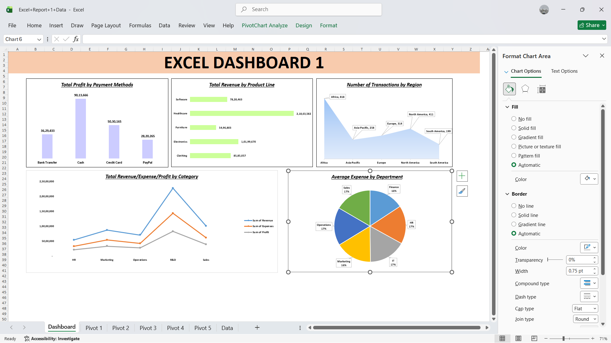

# Data Visualization & Chart Practice

## 📊 Project Overview
This project is an Excel dashboard built to practice core
data-visualization skills in Microsoft Excel. It demonstrates how
transaction data can be summarized with PivotTables and presented
through different chart types on one dashboard worksheet.
The main focus is learning PivotTables, charts, graphs, and dashboard
layout. No slicers were used, and no separate data-cleaning workflow
was performed as part of this project.

## 🎯 Project Objectives
* Practice creating different chart types in Excel.
* Summarize transaction data with PivotTables.
* Compare revenue, expenses, and profit across business categories.
* Visualize results by payment method, product line, region, and
  department.
* Use chart titles, labels, legends, and formatting to improve
  readability.
* Arrange multiple visualizations into a single dashboard.

## 🖼️ Dashboard Preview

## 📁 Workbook Structure
The workbook is organized into the following worksheets:
 * Worksheet     Purpose
 * Dashboard   Displays the five charts in one view.
 * Pivot 1     Supports one of the dashboard summaries.
 * Pivot 2     Supports one of the dashboard summaries.
 * Pivot 3     Supports one of the dashboard summaries.
 * Pivot 4     Supports one of the dashboard summaries.
 * Pivot 5     Supports one of the dashboard summaries.
 * Data        Contains the transaction dataset used for the summaries.
  
The Pivot sheets provide supporting summaries for the dashboard visuals.

### 🗃️ Dataset Overview
The dataset contains business transaction information, including fields
such as:
*Transaction ID and transaction date
* Revenue, expenses, and profit
* Business category and department
* Customer segment
* Payment method and discount
These fields make it possible to practice comparing financial measures
and grouping transactions by different business dimensions.

### 📈 Dashboard Charts
* 1. Total Profit by Payment Method
Chart type: Column chart
Compares total profit across Bank Transfer, Cash, Credit Card, and
PayPal. Vertical bars make it easy to compare the values for each
payment method.
Skills practiced: Column charts, category comparisons, data labels,
and chart formatting.
* 2. Total Revenue by Product Line
Chart type: Horizontal bar chart
Compares total revenue across Software, Healthcare, Furniture,
Electronics, and Clothing. Horizontal bars work well when category names
are longer.
Skills practiced: Bar charts, value labels, category comparison, and
formatting.
* 3. Number of Transactions by Region
Chart type: Area chart
Shows transaction counts for Africa, Asia-Pacific, Europe, North
America, and South America. This chart provides practice in presenting
grouped regional values with an area chart.
Skills practiced: Area charts, category labels, and data callouts.
* 4. Total Revenue, Expenses, and Profit by Category
Chart type: Line chart
Compares three measures---total revenue, total expenses, and total
profit---across HR, Marketing, Operations, R&D, and Sales.
The multiple lines make it easier to compare the measures across
categories and see how their values vary.
Skills practiced: Multi-series line charts, legends, axis
formatting, and comparison of measures.
* 5. Average Expense by Department
Chart type: Pie chart
Displays the distribution of average expenses across Finance, HR, IT,
Marketing, Operations, and Sales. The percentage labels help compare
each department's share of the displayed total.
Skills practiced: Pie charts, percentage labels, legends, and chart
layout.
* Chart-title clarification: The dashboard screenshot currently
labels this chart "Average Expense for Each Category." Because the
slices are departments, "Average Expense by Department" is a clearer
title. Update the title in Excel if it matches the source PivotTable.

## 🛠️ Tools and Excel Features
* Microsoft Excel
* PivotTables
* Column chart
* Horizontal bar chart
* Area chart
* Line chart
* Pie chart
* Data labels, legends, and chart titles
* Dashboard layout and formatting
  
## 🔄 Workflow
* 1. Use the provided dataset: Started with the transaction data
   available in the workbook.
* 2. Summarize the data: Used PivotTables to organize measures and
   categories for charting.
* 3. Create the charts: Built five charts to present different
   comparisons.
* 4. Design the dashboard: Arranged the charts on one worksheet and
   added titles and labels.
* 5. Review the visuals: Used different chart types to practice
   presenting summarized information clearly.
   
## 🚧 Project Scope and Limitations
This is a learning project focused on Excel visualization rather than a
full data-preparation pipeline.
* No slicers were added.
* No separate data-cleaning process was performed.
* The emphasis is on PivotTables, chart creation, formatting, and
  dashboard arrangement.
* The accuracy of the charts depends on the source dataset and the
  summaries used to create them.
The phrase "no separate data-cleaning process" describes the scope of
this project; it does not imply that the original dataset necessarily
contained errors.

## 📚 What I Learned
* How to create and format several chart types in Excel.
* How PivotTables can summarize data for visualization.
* How to compare financial measures across business categories.
* How to present product-line and regional information visually.
* How titles, labels, and legends help explain charts.
* How to combine multiple visuals into one dashboard worksheet.
  
## 🔮 Possible Future Improvements
* Add slicers and timeline filters for interactive exploration.
* Practice data cleaning and validation on a future version of the
  dataset.
* Improve consistency in number formats and chart titles.
* Add KPI cards for total revenue, total expenses, total profit, and
  transaction count.
* Document the source and meaning of each metric more explicitly.
* Explore Power Query and Power BI in a future project.

  
## ✅ Conclusion
This project helped me practice Microsoft Excel's data-visualization
features by turning summarized transaction data into a dashboard with
five different chart types. It is a foundation for future work with
interactive dashboards, data preparation, and more advanced reporting.
Project: Excel Dashboard 1
Tool: Microsoft Excel
Main focus: PivotTables, charts, graphs, and dashboard design
